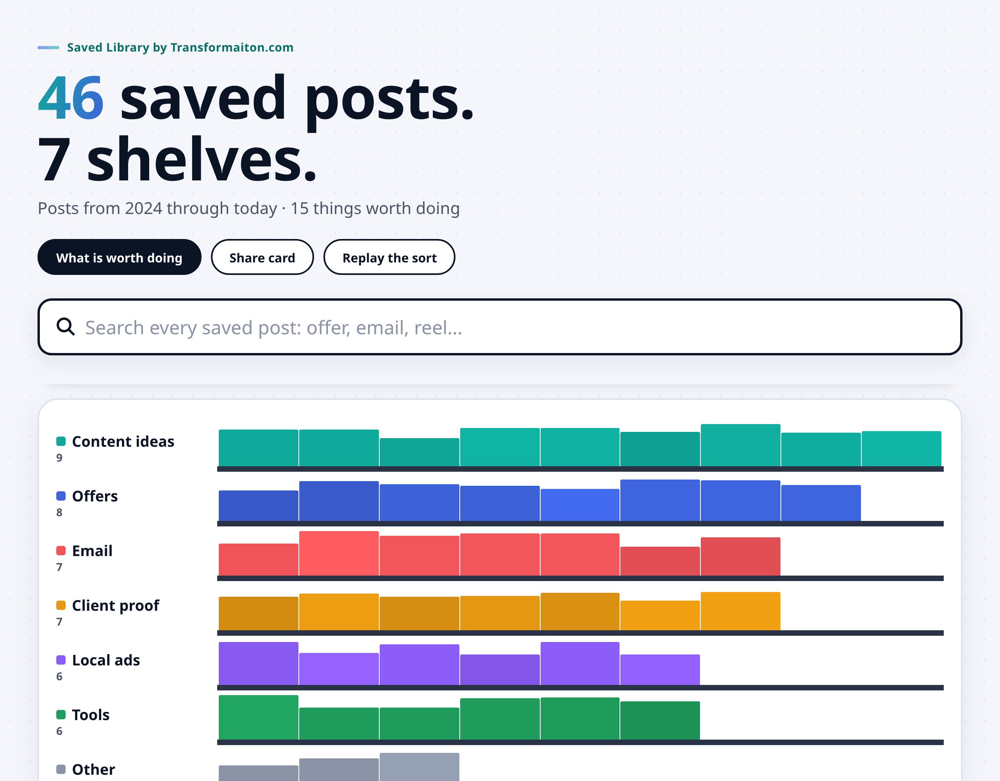
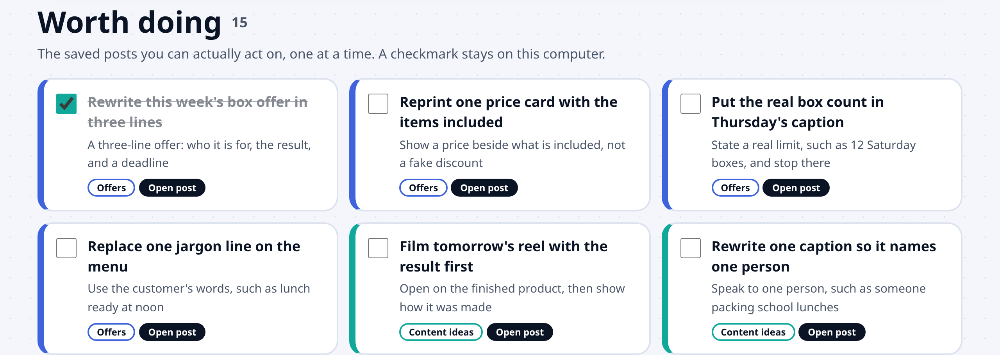
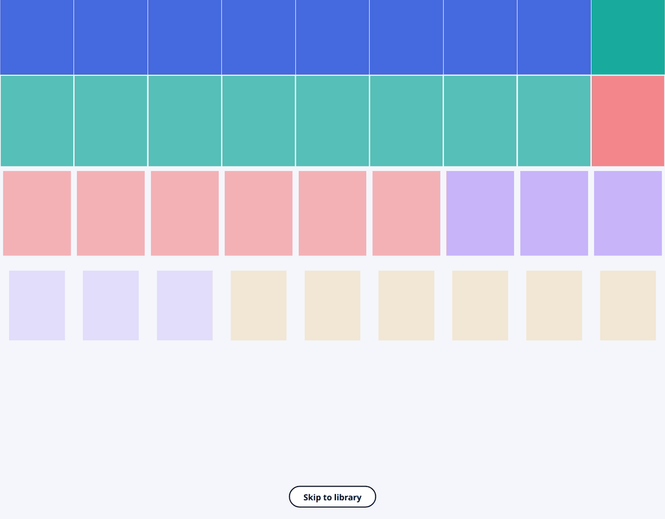
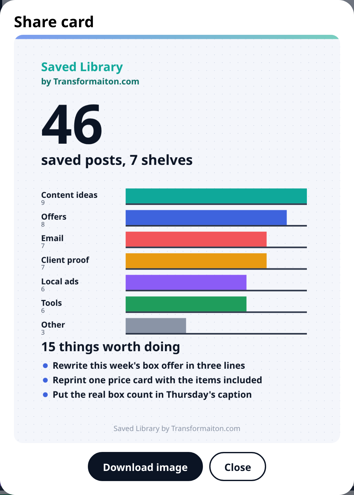

# Saved Library by Transformaiton.com

**The marketing ideas you saved on Instagram, sorted onto shelves.**

Saved Library reads your Instagram Saved folder, read-only. It sorts the posts by subject, writes one sentence for each, and gives you a short list of what is actually worth doing. When it finishes, a page opens on your computer: the wall of saved posts breaks apart onto a bookcase, with search and a card you can share.

It is for business owners who save a lot of marketing ideas on Instagram and never get back to them. Offers, captions, email lines, local ads, proof, tools. The shelves come from what you saved, not from a fixed list.



*Sample output from fictional posts, not a real Instagram account. The page is the real library this tool builds.*

- **Cost:** none. No API key and no extra subscription. It uses the assistant you already pay for.
- **Safe for the account:** read-only. No likes, no saves, no removals, and no clicks on Instagram.
- **Private:** the file and the page stay on your computer. Captions go only to the assistant you are already using, so it can summarize them.
- **You need:** a computer (not a phone), a browser logged in to Instagram (Chrome is the simplest), and Python 3.9 or newer.
- **And one assistant:** [Claude Code](https://claude.com/claude-code) (Claude Pro or higher), [Codex](https://chatgpt.com/codex) (included with paid ChatGPT), or ChatGPT with file upload (the free plan has a daily limit).

Full install notes: [docs/INSTALL.md](docs/INSTALL.md). How a run feels, and how to read the page: [docs/USAGE.md](docs/USAGE.md).

## Install

**Claude Code**

1. Install [Claude Code](https://claude.com/claude-code).
2. Open it and paste:

> Install the skill "Saved Library by Transformaiton.com" from https://github.com/Transformaiton/saved-library : download the repo into your skills folder, ~/.claude/skills/saved-library (if git is not installed, download the repository zip and extract it there). Then read SKILL.md in that folder and follow it to sort my saved Instagram posts. Talk to me in English.

If it asks to download or to run a command, approve it. With the Claude in Chrome extension it can read Saved itself. Without the extension it opens a page and you drag one bookmark.

**Codex**

Same request, with Codex's skills folder:

> Install the skill "Saved Library by Transformaiton.com" from https://github.com/Transformaiton/saved-library : download the repo into your skills folder, ~/.agents/skills/saved-library (if git is not installed, download the repository zip and extract it there). Then read SKILL.md in that folder and follow it to sort my saved Instagram posts. Talk to me in English.

Approve the download if it asks. Next time, open a new chat and write `Sort my saved posts`.

**ChatGPT only**

1. Open [this repository](https://github.com/Transformaiton/saved-library), choose **Code**, then **Download ZIP**. Double-click the zip. A `saved-library` folder appears.
2. Open `start.html` in that folder and read your saved posts with the button (steps 1 and 2 on the page).
3. In a new ChatGPT chat, attach the file that downloaded and `chatgpt/saved-library-chatgpt.py`. Paste the prompt from the button on the page, or from `chatgpt/prompt.txt`.

On a Mac, two prompts can appear the first time: one to install command-line tools (the first time Python runs), and one for access to Downloads. Approve both.

## What happens after "Sort my saved posts"

1. **Read.** If Claude in Chrome is connected, the tool reads on its own. If not, `start.html` opens. Drag the blue button to the bookmarks bar and click it on Instagram. About a minute per 100 saved posts.
2. **Sort.** The assistant reads every post, chooses shelves that fit what you saved, and writes one sentence each. About a minute per 100.
3. **The library.** `library.html` opens on your computer. You can come back to it any time, including with no network.

| What you get | What it looks like |
|---|---|
| A wall of every saved post that breaks apart onto a bookcase | About 6 seconds. You can film it |
| Search across every saved post | The matching books light up |
| Worth doing | Up to 15 practical actions, with a checkmark that stays on this computer |
| A shelf for each subject | One sentence per post, and a link to the original |
| A share card | An image ready for a story |







## Try these

- `Sort my saved posts.`
- `What did I save on Instagram that I could use this month?`
- `Build my Saved Library.`

After the page is open, search for a word you keep saving, such as `offer`, `email`, or `reel`. Check off an action when you have done it. **Replay the sort** plays the wall again. **Share card** downloads an image.

## Privacy

The read uses the same list Instagram loads when you scroll Saved. It sends read requests only. It does not like, save, unfollow, comment, or message anyone, and it does not read your password, your messages, or your followers.

The JSON file, the working files, and `library.html` stay in a folder on your computer. Captions are sent only to the assistant you opened them in, the same way any file you attach to a chat is. The page works later with no network.

Details of the read: [reference/collect.md](reference/collect.md).

## Good to know

The summaries are written by AI and can be wrong. Only the caption is read, not what is said in a video. Open the original post before you act on a summary.

## FAQ

**Will this touch my Instagram account?**
No. It is read-only. It does not like, save, remove, follow, or comment.

**Where does the data go?**
Onto your computer. The only copy that leaves the browser is the file you download, and the captions the assistant needs in order to summarize. Nothing is uploaded to Transformaiton.com.

**Does it work on my phone?**
No. Use a computer, logged in to Instagram in a desktop browser.

**What does it cost?**
No extra fee and no API key. Claude Code needs Claude Pro or higher. Codex is included with paid ChatGPT. ChatGPT's free plan can do a smaller run, within its daily file limit.

**How long does it take?**
About a minute of reading per 100 saved posts, then about a minute of sorting per 100. A thousand saves is usually a few minutes of reading plus a few minutes of sorting.

**Can I run it again?**
Yes. Open a new chat and write `Sort my saved posts`. Each run writes a new dated folder, so the previous page stays where it is.

**What about more than 3,000 saved posts?**
A run stops at 3,000 unless you raise the limit first. See [reference/collect.md](reference/collect.md).

**The bookmark does nothing.**
Drag the blue button, not the page. Some work computers block bookmarks that contain code. Claude in Chrome can read without the bookmark. Safari often refuses the drag: open `start.html` in Chrome.

## What is in this repository

```
SKILL.md                         instructions the assistant follows
start.html                       the bookmark that reads Saved, if you have no browser extension
scripts/collector.js             the read-only reader
scripts/library.py               prepare, check, and build the library
assets/library.html              the library page template
reference/sorting.md             how shelves and sentences are chosen
reference/collect.md             what the read does, and why it is read-only
chatgpt/                         the file and the prompt for ChatGPT
docs/INSTALL.md                  install steps for each assistant
docs/USAGE.md                    how to run it and how to read the page
```

## Credits

Saved Library by [Transformaiton.com](https://transformaiton.com/) is an English adaptation of [saved-library](https://github.com/Brain-ai-biz/saved-library) by Eden Bibas / Brain, used under the MIT License. The original copyright is kept in [LICENSE](LICENSE).

## Contact

[Transformaiton.com](https://transformaiton.com/) is an AI consultancy for small businesses.

- Website: [https://transformaiton.com/](https://transformaiton.com/)
- Email: [info@transformaiton.com](mailto:info@transformaiton.com)
- GitHub: [https://github.com/Transformaiton](https://github.com/Transformaiton)
